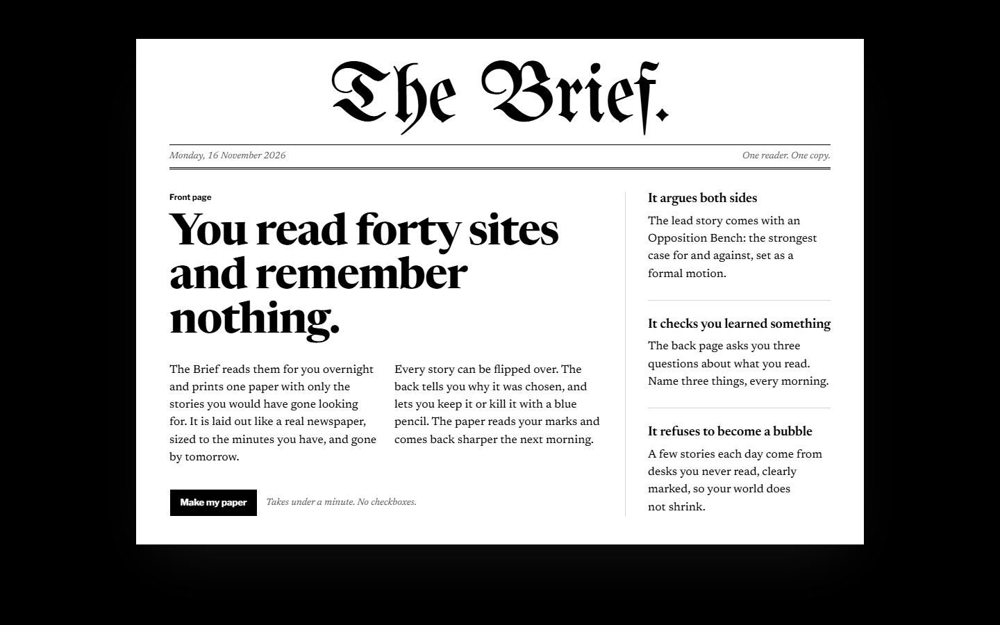

# The Brief.

One newspaper, made for one reader, every morning.

**3rd of 130 · NaSCon '26 AI Hackathon · built solo** · [Read today's edition →](https://the-brief-vert.vercel.app)



## How it works

- **Summarise once.** ~35 RSS desks (Dawn, Geo, BBC, Nature, ESPNcricinfo…) are pulled at 06:00 PKT. Each article is summarised, tagged and embedded (768-d, pgvector) exactly once, and that work is shared by every reader.
- **Rank per reader.** `0.45·similarity + 0.30·Thompson θ + 0.15·recency + 0.10·coverage`, then MMR (λ = 0.72) for diversity, with ~15% of slots forced *off your beat* so the paper can't shrink into a bubble.
- **Learn.** Keeps, kills, clicks, dwell time and quiz answers update a Beta prior per desk and nudge the reader vector. Evidence decays 3% a day.
- **Explain.** Every story flips to show why it was chosen. The Editor's Memo says what the paper believes about you, and you can overrule it in plain words.
- **One AI call per paper.** The editor's note, the Opposition Bench (the lead argued both ways) and the back-page quiz come from one Zod-validated call, with Gemini → Groq failover. Free tiers end to end.

Ranking formula and learning loop in full: [docs/ARCHITECTURE.md](docs/ARCHITECTURE.md)

## Run

```bash
npm install
cp .env.example .env.local
npm run db:setup && npm run ingest && npm run dev
```

<details>
<summary>Keys, demo data, deploy</summary>

| Variable | Where |
|---|---|
| `GEMINI_API_KEY` | aistudio.google.com/apikey |
| `GROQ_API_KEY` | console.groq.com/keys |
| `NEXT_PUBLIC_SUPABASE_URL`, `NEXT_PUBLIC_SUPABASE_ANON_KEY`, `SUPABASE_SERVICE_ROLE_KEY` | Supabase → Project Settings → API |
| `DATABASE_URL` | Supabase → Connect → Session pooler |
| `CRON_SECRET` | any long random string |

In Supabase → Authentication → Email, turn off "Confirm email".

`npm run seed:demo -- you@example.com` replays a week of reading, so the profile and memo show real learning.

Deploy: import on Vercel, add the same variables. `vercel.json` runs `/api/ingest` daily at 06:00 PKT.
</details>

---

Next.js 15 · TypeScript · Tailwind v4 · Motion · Supabase (Postgres, pgvector, Auth) · Gemini + Groq · Vercel
